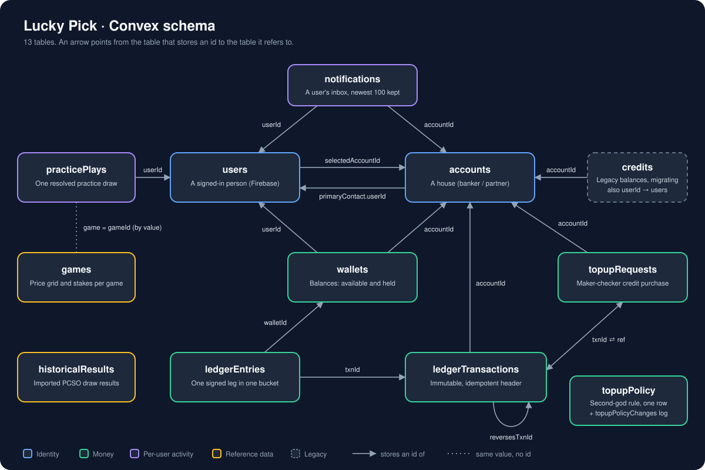

# Lucky Pick · Convex backend

The schema lives in [`schema.ts`](./schema.ts). It only assembles the tables;
each table's fields are defined in its own folder's `d.ts` (or `v.ts` for
`users`). Read [`_generated/ai/guidelines.md`](./_generated/ai/guidelines.md)
before changing Convex code.

An arrow points from the table that stores an id to the table it refers to.

## Tables

| Table | What one row is | Fields defined in |
| --- | --- | --- |
| `users` | A signed-in person, keyed by their Firebase identity. | `users/v.ts` |
| `accounts` | A house (banker / partner) that players play against. | `accounts/d.ts` |
| `wallets` | A balance, split into `available` and `held`. | `ledger/d.ts` |
| `ledgerTransactions` | The immutable header of one money movement. | `ledger/d.ts` |
| `ledgerEntries` | One signed leg of a transaction, in one wallet bucket. | `ledger/d.ts` |
| `topupRequests` | A request to buy credits for an account: filed by one god, approved by another, then claimed by the account's contact, which is what mints. | `money/d.ts` |
| `topupPolicy` | The single row holding the switchable top-up rule: whether a different god must decide a request. | `money/d.ts` |
| `topupPolicyChanges` | One logged switch of that rule, with who made it. Never trimmed. | `money/d.ts` |
| `games` | One of the five games as the house configures it: price grid, stakes, prizes. | `games/d.ts` |
| `practicePlays` | One resolved practice draw and its best tickets. | `plays/d.ts` |
| `notifications` | One event in a user's inbox. | `notifications/d.ts` |
| `historicalResults` | One imported PCSO draw result. | `resultValidators.ts` |
| `credits` | Legacy per-account balance from before the ledger. | `credits/d.ts` |

## How the tables are related

### Identity

- `users.selectedAccountId` → `accounts`: the house the player chose to play against (optional).
- `accounts.primaryContact.userId` → `users`: the person the platform talks to for the house. It is `null` until that contact signs in, because an account can be created before its contact has an identity. The contact is stored in the same shape as a `users` document.
- `accounts.ownerTokenIdentifier`, `createdBy`, `updatedBy`, `closedBy` and `confirmedBy` hold a user's `tokenIdentifier` as a string, not a document id. The same goes for `makerTokenIdentifier` / `checkerTokenIdentifier` on top-ups and `actorTokenIdentifier` on ledger transactions.

### Money

- `wallets.accountId` → `accounts` and `wallets.userId` → `users`, both nullable. Which ones are set depends on `kind`:

  | `kind` | Belongs to | Purpose |
  | --- | --- | --- |
  | `user` | a user, within an account | what a player can spend |
  | `partnerFloat` | an account | credits the house bought to hand out |
  | `partnerEarnings` | an account | what the house's draws have won from players |
  | `system` | nobody; identified by `systemKey` (`issuance`, `platformFees`) | the platform's own wallets |

- `ledgerEntries.txnId` → `ledgerTransactions` and `ledgerEntries.walletId` → `wallets`. A transaction has two or more entries; each entry moves one bucket of one wallet and records `balanceAfter`.
- `ledgerTransactions.accountId` → `accounts` (nullable): the house the movement concerns.
- `ledgerTransactions.reversesTxnId` → `ledgerTransactions`: set on a reversal, pointing at the transaction it undoes.
- `ledgerTransactions.ref` is a tagged pointer to the business record behind the movement. Today that is `{ type: 'topup', id }` → `topupRequests`, or `{ type: 'migration', id }` with the id of a retired `credits` row as a string.
- `topupRequests.accountId` → `accounts`, and `topupRequests.txnId` → `ledgerTransactions` once claimed (`approved` only means it is waiting to be claimed; requests approved before claiming existed minted on approval and already carry a `txnId`). Together with `ref`, a top-up and its mint can be traced in both directions.
- `topupPolicy` and `topupPolicyChanges` reference no other table. No `topupPolicy` row means the rule is on. Only a top god can switch it (`money.topups.setSecondGodRule`), and each switch adds a `topupPolicyChanges` row.

### Per-user activity

- `practicePlays.userId` → `users`. `practicePlays.game` holds the same value as `games.gameId` (`'6/42'` … `'6/58'`), but it is not a document reference.
- `notifications.userId` → `users` (the recipient) and `notifications.accountId` → `accounts` (nullable). `accountName` is copied in so the row still reads correctly if the house is renamed.

### Reference data

- `games` and `historicalResults` reference no other table. `games` is looked up by `gameId`. `historicalResults.game` uses the PCSO vocabulary (`'lotto'`, `'mega'`, …), which is a different naming from `games.gameId`.

### Legacy

- `credits.accountId` → `accounts` and `credits.userId` → `users` (nullable). `migrations/creditsToWallets.ts` moves each balance into the account's `partnerFloat` wallet and deletes the row. Nothing else should read or write this table.

## Rules the schema does not enforce

- Only `post()` in `ledger/post.ts` writes `wallets.available` and `wallets.held`. Every posting is balanced, so all wallets sum to zero; `issuance` is negative by exactly the credits outstanding.
- `ledgerTransactions.idempotencyKey` is unique. `post()` enforces it, since a Convex index cannot, and `payloadHash` distinguishes a safe retry from a reused key.
- `wallets.floor` is the lowest `available` may go: `0` for anything a person spends from, `null` for issuance and partner earnings.
- 1 credit = ₱1, and amounts are whole credits.
- `practicePlays` keeps the newest 200 rows per user and `notifications` the newest 100; older rows are deleted on write.
- `games` is seeded from `src/lib/games.ts`, which stays the app's fallback when the table is empty. Each row carries six `betTypes` cells (`enabled`, `ticketCost`, `stakes`).

## Indexes

| Table | Indexes |
| --- | --- |
| `users` | `by_tokenIdentifier`, `by_firebaseUid`, `by_email` |
| `accounts` | `by_slug`, `by_createdAt`, `by_status_and_createdAt`, `by_ownerTokenIdentifier_and_createdAt`, `by_primaryContact_tokenIdentifier`, `by_primaryContact_email`, `by_primaryContact_firebaseUid` |
| `wallets` | `by_accountId_and_kind`, `by_accountId_and_userId`, `by_userId`, `by_systemKey` |
| `ledgerTransactions` | `by_idempotencyKey`, `by_accountId_and_createdAt`, `by_reversesTxnId` |
| `ledgerEntries` | `by_walletId_and_createdAt`, `by_txnId` |
| `topupRequests` | `by_status_and_createdAt`, `by_accountId_and_createdAt`, `by_accountId_and_status` |
| `topupPolicy`, `topupPolicyChanges` | none; read in creation order |
| `games` | `by_gameId`, `by_order` |
| `practicePlays` | `by_userId_and_drawnAt` |
| `notifications` | `by_userId_and_createdAt` |
| `historicalResults` | `by_drawId`, `by_game`, `by_game_and_date` |
| `credits` | `by_accountId`, `by_accountId_and_userId`, `by_userId`, `by_accountSlug_and_userTokenIdentifier` |

## Folder layout

Each domain folder follows the same naming: `d.ts` holds validators and field
definitions, `q.ts` queries, `m.ts` mutations, `helpers.ts` shared logic, and
`*.test.ts` the tests. Shared auth checks are in `lib/auth.ts`.

When the schema changes, update this file and [`schema.svg`](./schema.svg).
